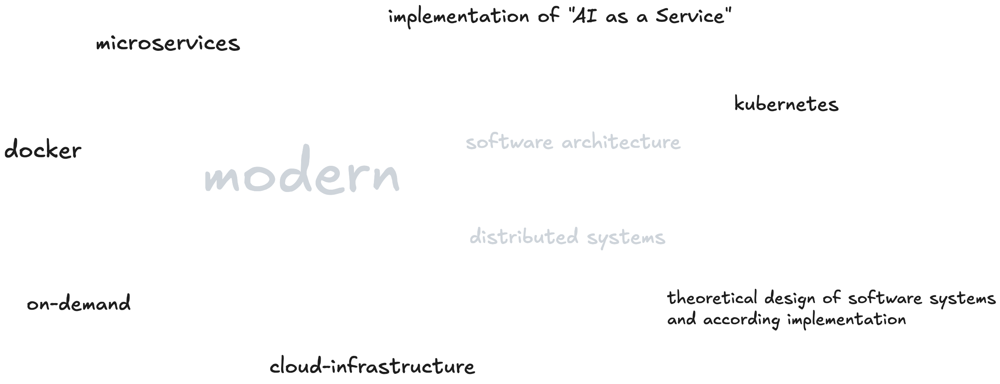
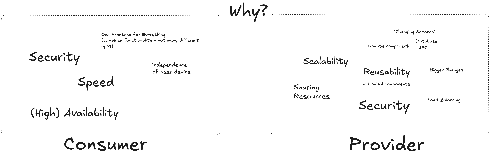

# hft-26-winter

Modern Distributed Systems – HFT Stuttgart, winter semester 2026/27

## Organisation

- Slides and recordings go to the shared folder. This repository documents what we did in each session.
- Every session gets **learning objectives** and **review questions**. If you can answer the review questions, you are well prepared for the exam. Some exam questions are taken from them.
- Default is on-site, Friday morning. If a session has to be remote, you will be told by Thursday.
- Code and documentation for submissions in English, please. Any Git repository that is accessible to the lecturer is fine (GitHub, HFT GitLab, ...).
- Background talk: [From Classroom To Container: Teaching Distributed Systems With CNCF & Cloud Native Technologies](https://www.youtube.com/watch?v=7Dt5QAK9bkE) (KubeCon + CloudNativeCon Europe 2026)

## Exam

As of now, nothing is expected to change from last year:

- Written exam, 2 hours, 120 points (roughly one point per minute).
- Allowed: one cheat sheet, DIN A4, front and back, in any style. It is collected with the exam. Obvious copies of someone else's cheat sheet lead to point deduction.
- Expect both reasoning questions ("why?") and practical ones, e.g. short code snippets: what do they do, how do they relate to distributed systems, what could go wrong?
- The review questions of each session are the best preparation. Hands-on work in the PVL helps a lot with the practical questions.

## 2026-Oct-16 Kick-off: Why Distributed Systems?

### Brainstorming: Modern Software Architecture / Distributed Systems

### Why distribute? Consumer and Provider View

### **Content Overview**

**Starting point**
   - Anonymous survey on prior knowledge (languages, communication, databases, containers, Kubernetes, AI).
   - Polyglot: components talk over universal protocols, so the language inside a component is your choice. AI plays two roles: helping us build, and being part of the application.

**What makes a distributed system a distributed system?**
   - Multiple components, connected over a network, working towards one common goal, and looking like one system to its users.

**Why distribute? Two perspectives**
   - Consumer: speed, (high) availability, security, independence of the user device.
   - Provider: scalability, load balancing, sharing resources, reusability, updating individual components.
   - The consumer's expectations are met by the provider's means, e.g. high availability through scalability and redundancy.
   - Over-engineering: not every application needs this. Running a single instance on a full Kubernetes setup is a common anti-pattern.

**Reasons in more detail**
   - Heterogeneity: different hardware/OS stacks (mainframe, Unix, Linux), different components (database, message broker, security), different languages and frameworks.
   - People: splitting a large effort into autonomous teams with clear component boundaries (preview of Conway's Law).
   - Resilience: redundancy, load balancing, circuit breaker/bulkhead, rate limiting.
   - Security: authentication and authorisation as a dedicated component in front of the services.
   - Dynamic updates: blue/green switch, incremental/percentage rollouts, opt-in routing via cookie.

**Basic ingredients of a distributed system**
   - Network, a common protocol, a service registry ("telephone book"), dynamic configuration, observability.

**From frameworks to platforms**
   - Before containers: distributed functionality inside the application (Netflix OSS / Spring Cloud: Eureka, Ribbon, Hystrix, Zuul).
   - Containers (Docker): same runtime and command for every component, virtual networks, easy swapping of components. Limits of plain Docker/Compose: no rolling updates, scaled instances only get basic DNS round-robin, no health-aware load balancing.
   - Kubernetes: Deployments for updates, ReplicaSets for the number of instances, Services for a stable endpoint that distributes traffic across instances.
   - Service meshes: fine-grained routing between services (percentage, header/cookie-based) and encrypted service-to-service communication (mTLS) beyond what plain Kubernetes Services offer.
   - Observability with OpenTelemetry: metrics, traces and logs from polyglot components, made visible.

**CNCF**
   - The Cloud Native Computing Foundation (part of the Linux Foundation) and its landscape: from a handful of projects in 2017 to today's full map.

**PVL outlook**
   - Last year: a small multi-service system with Docker Compose plus at least one meaningful OSS/CNCF tool, documented in a README. See [hft-25-winter](https://github.com/maeddes/hft-25-winter).
   - This year: going in a similar direction, likely with more Kubernetes (optional) and an AI aspect (how AI was used to build it, or an AI service integrated into it). Description follows.

**Q&A: Docker vs. Podman**
   - Both are fine. Examples here use Docker. Kubernetes uses containerd or CRI-O rather than Docker as its runtime. Docker itself runs on containerd, and the low-level runtime underneath is runc in both cases. Images built with Docker run everywhere, since they follow the OCI standard.

---

### **Learning Objectives**

By the end of this lecture, students will be able to:
- Describe what makes a distributed system a distributed system.
- Explain why a system is distributed, from the consumer and from the provider perspective.
- Relate consumer expectations (speed, availability, security) to the provider-side mechanisms that achieve them (scaling, load balancing, resilience patterns, dynamic updates).
- Recognise when a distributed architecture is over-engineering.
- Name the basic ingredients of a distributed system.
- Outline how distributed functionality moved from application frameworks to containers, Kubernetes and service meshes.
- Explain the role of the CNCF and its landscape.

---

### **Student/Review Questions**

1. What makes a distributed system a distributed system? Is a set of computers next to each other a distributed system?
2. List three advantages of a distributed system on the consumer side. Explain how they can be achieved on the provider side.
3. Name two reasons for distribution from the provider perspective, one technical and one organisational.
4. Why is high availability one of the main drivers for distributed systems? Give an example where a monolith would be good enough.
5. Explain the difference between scaling for high availability and scaling for load.
6. What is the purpose of a circuit breaker and of rate limiting?
7. Describe a blue/green update. What is its advantage over stop-and-restart, and how do percentage or cookie-based rollouts go further?
8. Which basic ingredients does a distributed system need? What is the role of a service registry?
9. Where did frameworks like Spring Cloud / Netflix OSS place distributed functionality, and where do containers and Kubernetes place it?
10. What can't plain Docker do that Kubernetes provides? What can a service mesh do that plain Kubernetes doesn't?
11. Why does observability become more important when a system is distributed?
12. What is the CNCF and what is the CNCF landscape?

## 2026-Oct-23 Distributed System Patterns, Cloud Models, Cloud Development Environments

### **Content Overview**

**Recap and organisation**
   - Moodle is the central entry point and links to everything else: Zoom, the shared folder (recordings and slides, prefixed with the date) and this repository.
   - The Menti survey is not a prerequisite. It only shows where the class is starting from.
   - Programming fundamentals are expected, but the language is secondary. AI is encouraged, as long as you can explain what your code does.

**Distributed system patterns**
   - Recap: networked components with a common goal, one system for the clients. Reasons: heterogeneity (environments, components, frameworks, versions), extensibility, redundancy, load balancing, resilience and rate limiting, security, dynamic updates (blue/green, canary).
   - Requirements for implementing distributed systems:
     - Communication: a common protocol, not just a network cable.
     - Routing and traffic shaping: route, distribute, throttle, block.
     - Service registration and discovery: a "telephone book" where services register and look each other up.
     - Distributed configuration: changing configuration at runtime, e.g. feature flags, for some or all instances.
     - Distributed logging and tracing: detect a problem, isolate the component, find the root cause.
   - "It's all about the network": the eight Fallacies of Distributed Computing (Peter Deutsch and colleagues at Sun, 1994; #8 added by James Gosling). Applications must expect network failures and handle them with timeouts, retries and meaningful errors instead of crashing.

**Cloud technology evolution**
   - NIST definition of cloud computing (SP 800-145, September 2011): a *model* for ubiquitous, convenient, on-demand network access to a shared pool of configurable computing resources that can be rapidly provisioned and released. It consists of five essential characteristics, three service models and four deployment models.
   - Elasticity: add resources for peaks (Black Friday), release them when demand drops, pay for what you use.
   - "Cloud technologies" mixes two things: providers (AWS, Azure, Google Cloud, ...) and technologies (Docker, Kubernetes, serverless functions, ...). The provider market consolidated quickly; AWS took an early lead with virtual machines.
   - Service models by consumer: IaaS for operations (no hardware to manage), PaaS for developers (build and run applications without managing the platform), SaaS for end users (Zoom, Google Drive). Higher abstraction means less work but less freedom. "Everything as a service": FaaS, DBaaS, storage, network, ...
   - The CNCF landscape from 2017 to today: categories, maturity levels, the landscape guide, project activity. Different models for grouping technologies (NIST, CNCF, a layered model with security and observability as cross-cutting concerns).
   - Technologies to highlight this semester: Docker, Kubernetes, OpenTelemetry, eBPF and Cilium, Backstage.

**Cloud development environments**
   - Why: everyone gets the same conditions, no time lost debugging local installations.
   - Demo of GitHub Codespaces: a development environment in the cloud, opened in the browser, with Java, Python, Node and Docker preinstalled. It behaves like a Git client: changes need to be committed and pushed.
   - The free plan includes 120 core-hours per month (60 hours on the default 2-core machine). Usage is billed to the account that creates the codespace.
   - Gitpod Classic ended in October 2025 (now Ona). Other options exist; local development is fine if you can run it reliably yourself.
   - Is Codespaces IaaS, PaaS or SaaS? Each answer can be right – it depends on the reasoning.

### **Homework**

- Create a GitHub account if you don't have one. Verified students can get the [GitHub Student Developer Pack](https://education.github.com/pack) with more Codespaces hours.

---

### **Learning Objectives**

By the end of this lecture, students will be able to:
- Name the building blocks every distributed system needs and explain each of them.
- Explain service registration and discovery.
- List the Fallacies of Distributed Computing and explain how an application should deal with them.
- Explain the NIST definition of cloud computing and its key terms.
- Distinguish IaaS, PaaS and SaaS by their typical consumer and responsibility, and classify a given service with reasons.
- Use the CNCF landscape to find and assess technologies.
- Explain the purpose of cloud development environments.

---

### **Student/Review Questions**

1. Which building blocks does every distributed system need, regardless of its business functionality?
2. Explain service registration and discovery. Why is a fixed list of addresses not enough in a dynamic system?
3. Why is changing configuration at runtime harder than at startup? Give an example.
4. Why is debugging harder in a distributed system? Describe the steps from detecting a problem to its root cause.
5. List three Fallacies of Distributed Computing and give an example of what goes wrong if you rely on each.
6. Service A calls service B and the network fails. What can A do instead of crashing?
7. Explain the terms "model", "ubiquitous", "shared pool" and "rapidly provisioned and released" from the NIST definition.
8. What is elasticity and why does it matter for cost?
9. Distinguish IaaS, PaaS and SaaS. Who is the typical consumer of each? Give an example for each.
10. Classify GitHub Codespaces as IaaS, PaaS or SaaS and justify your answer.
11. Why is a list like "AWS, Azure, Docker, Kubernetes" a misleading answer to "what are cloud technologies"?
12. What do the CNCF maturity levels tell you about a project, and what don't they tell you?
13. Why would a team or a class use a cloud development environment?
