# hft-26-winter

Modern Distributed Systems – HFT Stuttgart, winter semester 2026/27

## Organisation

- Slides and recordings go to the shared folder. This repository documents what we did in each session.
- Every session gets **learning objectives** and **review questions**. If you can answer the review questions, you are well prepared for the exam. Some exam questions are taken from them.
- Default is on-site, Friday morning. If a session has to be remote, you will be told by Thursday.
- Code and documentation for submissions in English, please. Any Git repository that is accessible to the lecturer is fine (GitHub, HFT GitLab, ...).
- Background talk: [From Classroom To Container: Teaching Distributed Systems With CNCF & Cloud Native Technologies](https://www.youtube.com/watch?v=7Dt5QAK9bkE) (KubeCon + CloudNativeCon Europe 2026)

## Exam

As of now, nothing is expected to change from last year:

- Written exam, 2 hours, 120 points (roughly one point per minute).
- Allowed: one cheat sheet, DIN A4, front and back, in any style. It is collected with the exam. Obvious copies of someone else's cheat sheet lead to point deduction.
- Expect both reasoning questions ("why?") and practical ones, e.g. short code snippets: what do they do, how do they relate to distributed systems, what could go wrong?
- The review questions of each session are the best preparation. Hands-on work in the PVL helps a lot with the practical questions.

## Tutorials

Step-by-step walkthroughs to try things yourself, one command at a time:

1. [Docker Basics](tutorials/01-docker-basics.md) – pull, run, inspect, build your first image
2. [A REST API in a Container](tutorials/02-rest-api-in-a-container.md) – from a Python process to a containerized API
3. [Looking Inside Containers](tutorials/03-looking-inside-containers.md) – interactive shells, `docker exec`, the writable layer, `docker commit` vs. Dockerfile
4. [Container Networking](tutorials/04-container-networking.md) – connecting frontend and backend: names, networks, a toolbox container, ports
5. [Cleaning Up](tutorials/05-cleaning-up.md) – removing containers, images, networks, volumes and build cache
6. [Docker Compose](tutorials/06-docker-compose.md) – the frontend/backend setup by hand and with Compose
7. [Scaling](tutorials/07-scaling.md) – a load balancer between frontend and backend, several backend instances
8. [State](tutorials/08-state.md) – the in-memory problem, a database and a volume (draft)

## 2026-Oct-16 Kick-off: Why Distributed Systems?

### Brainstorming: Modern Software Architecture / Distributed Systems

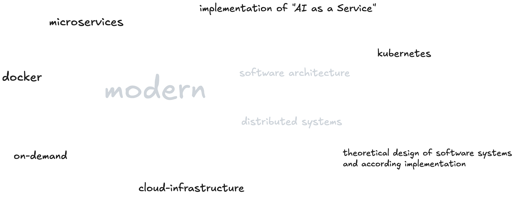

### Why distribute? Consumer and Provider View

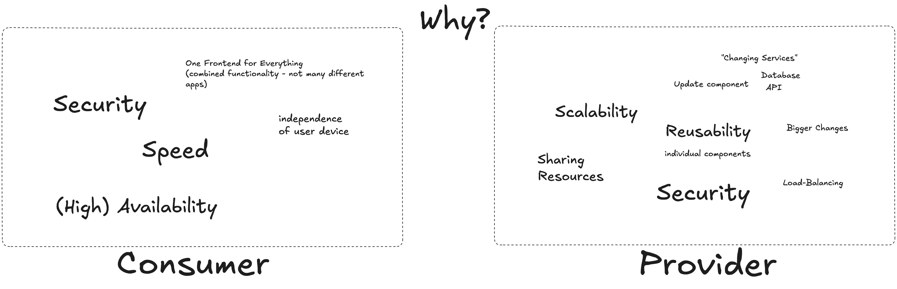

### **Content Overview**

**Starting point**
   - Anonymous survey on prior knowledge (languages, communication, databases, containers, Kubernetes, AI).
   - Polyglot: components talk over universal protocols, so the language inside a component is your choice. AI plays two roles: helping us build, and being part of the application.

**What makes a distributed system a distributed system?**
   - Multiple components, connected over a network, working towards one common goal, and looking like one system to its users.

**Why distribute? Two perspectives**
   - Consumer: speed, (high) availability, security, independence of the user device.
   - Provider: scalability, load balancing, sharing resources, reusability, updating individual components.
   - The consumer's expectations are met by the provider's means, e.g. high availability through scalability and redundancy.
   - Over-engineering: not every application needs this. Running a single instance on a full Kubernetes setup is a common anti-pattern.

**Reasons in more detail**
   - Heterogeneity: different hardware/OS stacks (mainframe, Unix, Linux), different components (database, message broker, security), different languages and frameworks.
   - People: splitting a large effort into autonomous teams with clear component boundaries (preview of Conway's Law).
   - Resilience: redundancy, load balancing, circuit breaker/bulkhead, rate limiting.
   - Security: authentication and authorisation as a dedicated component in front of the services.
   - Dynamic updates: blue/green switch, incremental/percentage rollouts, opt-in routing via cookie.

**Basic ingredients of a distributed system**
   - Network, a common protocol, a service registry ("telephone book"), dynamic configuration, observability.

**From frameworks to platforms**
   - Before containers: distributed functionality inside the application (Netflix OSS / Spring Cloud: Eureka, Ribbon, Hystrix, Zuul).
   - Containers (Docker): same runtime and command for every component, virtual networks, easy swapping of components. Limits of plain Docker/Compose: no rolling updates, scaled instances only get basic DNS round-robin, no health-aware load balancing.
   - Kubernetes: Deployments for updates, ReplicaSets for the number of instances, Services for a stable endpoint that distributes traffic across instances.
   - Service meshes: fine-grained routing between services (percentage, header/cookie-based) and encrypted service-to-service communication (mTLS) beyond what plain Kubernetes Services offer.
   - Observability with OpenTelemetry: metrics, traces and logs from polyglot components, made visible.

**CNCF**
   - The Cloud Native Computing Foundation (part of the Linux Foundation) and its landscape: from a handful of projects in 2017 to today's full map.

**PVL outlook**
   - Last year: a small multi-service system with Docker Compose plus at least one meaningful OSS/CNCF tool, documented in a README. See [hft-25-winter](https://github.com/maeddes/hft-25-winter).
   - This year: going in a similar direction, likely with more Kubernetes (optional) and an AI aspect (how AI was used to build it, or an AI service integrated into it). Description follows.

**Q&A: Docker vs. Podman**
   - Both are fine. Examples here use Docker. Kubernetes uses containerd or CRI-O rather than Docker as its runtime. Docker itself runs on containerd, and the low-level runtime underneath is runc in both cases. Images built with Docker run everywhere, since they follow the OCI standard.

---

### **Learning Objectives**

By the end of this lecture, students will be able to:
- Describe what makes a distributed system a distributed system.
- Explain why a system is distributed, from the consumer and from the provider perspective.
- Relate consumer expectations (speed, availability, security) to the provider-side mechanisms that achieve them (scaling, load balancing, resilience patterns, dynamic updates).
- Recognise when a distributed architecture is over-engineering.
- Name the basic ingredients of a distributed system.
- Outline how distributed functionality moved from application frameworks to containers, Kubernetes and service meshes.
- Explain the role of the CNCF and its landscape.

---

### **Student/Review Questions**

1. What makes a distributed system a distributed system? Is a set of computers next to each other a distributed system?
2. List three advantages of a distributed system on the consumer side. Explain how they can be achieved on the provider side.
3. Name two reasons for distribution from the provider perspective, one technical and one organisational.
4. Why is high availability one of the main drivers for distributed systems? Give an example where a monolith would be good enough.
5. Explain the difference between scaling for high availability and scaling for load.
6. What is the purpose of a circuit breaker and of rate limiting?
7. Describe a blue/green update. What is its advantage over stop-and-restart, and how do percentage or cookie-based rollouts go further?
8. Which basic ingredients does a distributed system need? What is the role of a service registry?
9. Where did frameworks like Spring Cloud / Netflix OSS place distributed functionality, and where do containers and Kubernetes place it?
10. What can't plain Docker do that Kubernetes provides? What can a service mesh do that plain Kubernetes doesn't?
11. Why does observability become more important when a system is distributed?
12. What is the CNCF and what is the CNCF landscape?

## 2026-Oct-23 Distributed System Patterns, Cloud Models, Cloud Development Environments

### **Content Overview**

**Recap and organisation**
   - Moodle is the central entry point and links to everything else: Zoom, the shared folder (recordings and slides, prefixed with the date) and this repository.
   - The Menti survey is not a prerequisite. It only shows where the class is starting from.
   - Programming fundamentals are expected, but the language is secondary. AI is encouraged, as long as you can explain what your code does.

**Distributed system patterns**
   - Recap: networked components with a common goal, one system for the clients. Reasons: heterogeneity (environments, components, frameworks, versions), extensibility, redundancy, load balancing, resilience and rate limiting, security, dynamic updates (blue/green, canary).
   - Requirements for implementing distributed systems:
     - Communication: a common protocol, not just a network cable.
     - Routing and traffic shaping: route, distribute, throttle, block.
     - Service registration and discovery: a "telephone book" where services register and look each other up.
     - Distributed configuration: changing configuration at runtime, e.g. feature flags, for some or all instances.
     - Distributed logging and tracing: detect a problem, isolate the component, find the root cause.
   - "It's all about the network": the eight Fallacies of Distributed Computing (Peter Deutsch and colleagues at Sun, 1994; #8 added by James Gosling). Applications must expect network failures and handle them with timeouts, retries and meaningful errors instead of crashing.

**Cloud technology evolution**
   - NIST definition of cloud computing (SP 800-145, September 2011): a *model* for ubiquitous, convenient, on-demand network access to a shared pool of configurable computing resources that can be rapidly provisioned and released. It consists of five essential characteristics, three service models and four deployment models.
   - Elasticity: add resources for peaks (Black Friday), release them when demand drops, pay for what you use.
   - "Cloud technologies" mixes two things: providers (AWS, Azure, Google Cloud, ...) and technologies (Docker, Kubernetes, serverless functions, ...). The provider market consolidated quickly; AWS took an early lead with virtual machines.
   - Service models by consumer: IaaS for operations (no hardware to manage), PaaS for developers (build and run applications without managing the platform), SaaS for end users (Zoom, Google Drive). Higher abstraction means less work but less freedom. "Everything as a service": FaaS, DBaaS, storage, network, ...
   - The CNCF landscape from 2017 to today: categories, maturity levels, the landscape guide, project activity. Different models for grouping technologies (NIST, CNCF, a layered model with security and observability as cross-cutting concerns).
   - Technologies to highlight this semester: Docker, Kubernetes, OpenTelemetry, eBPF and Cilium, Backstage.

**Cloud development environments**
   - Why: everyone gets the same conditions, no time lost debugging local installations.
   - Demo of GitHub Codespaces: a development environment in the cloud, opened in the browser, with Java, Python, Node and Docker preinstalled. It behaves like a Git client: changes need to be committed and pushed.
   - The free plan includes 120 core-hours per month (60 hours on the default 2-core machine). Usage is billed to the account that creates the codespace.
   - Gitpod Classic ended in October 2025 (now Ona). Other options exist; local development is fine if you can run it reliably yourself.
   - Is Codespaces IaaS, PaaS or SaaS? Each answer can be right – it depends on the reasoning.

### **Homework**

- Create a GitHub account if you don't have one. Verified students can get the [GitHub Student Developer Pack](https://education.github.com/pack) with more Codespaces hours.

---

### **Learning Objectives**

By the end of this lecture, students will be able to:
- Name the building blocks every distributed system needs and explain each of them.
- Explain service registration and discovery.
- List the Fallacies of Distributed Computing and explain how an application should deal with them.
- Explain the NIST definition of cloud computing and its key terms.
- Distinguish IaaS, PaaS and SaaS by their typical consumer and responsibility, and classify a given service with reasons.
- Use the CNCF landscape to find and assess technologies.
- Explain the purpose of cloud development environments.

---

### **Student/Review Questions**

1. Which building blocks does every distributed system need, regardless of its business functionality?
2. Explain service registration and discovery. Why is a fixed list of addresses not enough in a dynamic system?
3. Why is changing configuration at runtime harder than at startup? Give an example.
4. Why is debugging harder in a distributed system? Describe the steps from detecting a problem to its root cause.
5. List three Fallacies of Distributed Computing and give an example of what goes wrong if you rely on each.
6. Service A calls service B and the network fails. What can A do instead of crashing?
7. Explain the terms "model", "ubiquitous", "shared pool" and "rapidly provisioned and released" from the NIST definition.
8. What is elasticity and why does it matter for cost?
9. Distinguish IaaS, PaaS and SaaS. Who is the typical consumer of each? Give an example for each.
10. Classify GitHub Codespaces as IaaS, PaaS or SaaS and justify your answer.
11. Why is a list like "AWS, Azure, Docker, Kubernetes" a misleading answer to "what are cloud technologies"?
12. What do the CNCF maturity levels tell you about a project, and what don't they tell you?
13. Why would a team or a class use a cloud development environment?

## 2026-Oct-30 Containers: Why, Containers vs. VMs, Docker Basics

### Brainstorming: Containers – What, Why, How?

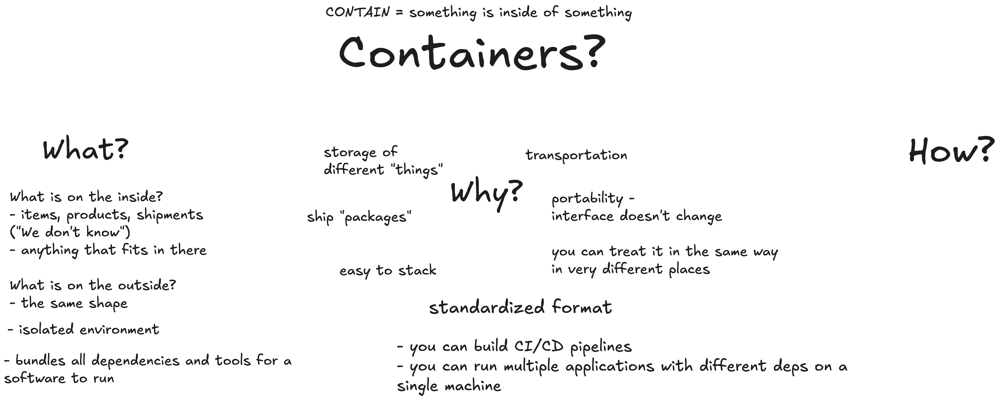

### The DevOps Problem

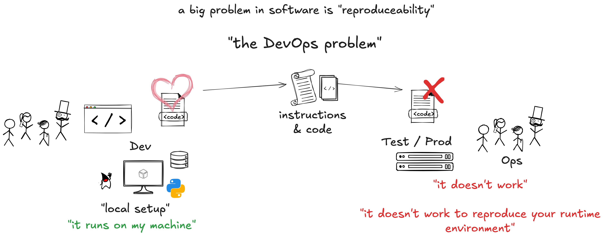

### Containers as a Standardized Format

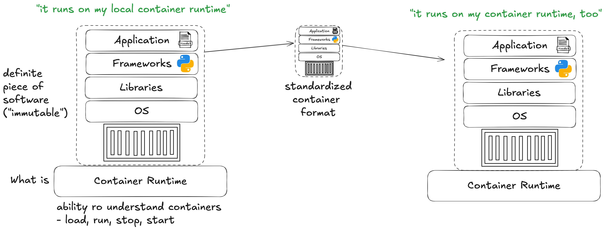

### **Content Overview**

**What is a container? Starting from shipping containers**
   - Inside: anything that fits – from the outside you can't tell. Outside: always the same shape, so the interface never changes. Cranes, ships, trucks and trains handle every container the same way, anywhere in the world.
   - Containers are easy to stack and don't know about each other.
   - Background: the modern shipping container goes back to Malcom McLean, whose converted tanker *Ideal X* carried 58 containers from Newark to Houston in April 1956.

**The DevOps problem: reproducibility**
   - Developers build and test on their local setup: "it runs on my machine". Operations get code plus written instructions and try to reproduce the environment – and often fail, because every machine and every manual step differs.
   - The container idea: ship the environment instead of instructions. An image bundles the application with its frameworks and libraries into one immutable piece of software. Any container runtime can load, run, stop and start it: "it runs on my container runtime, too".

**Containers vs. virtual machines**
   - Hypervisor type 1 runs directly on the hardware, type 2 on top of an operating system (e.g. a VM on a laptop). A VM virtualizes the hardware and carries a full guest operating system.
   - Containers run on top of an operating system and share its kernel. An image contains only the application with its libraries and, if needed, the userland of a distribution (e.g. Debian or Alpine libraries and tools) – never a kernel of its own.
   - Consequences: megabytes instead of gigabytes, seconds instead of minutes. Containers are cheap to start and to throw away; VMs tend to run long and carry state.
   - Containers usually talk to each other over virtual networks rather than inside one operating system.
   - Containers need a Linux kernel: on macOS and Windows, Docker runs a small Linux VM in the background. GUI applications are not a typical use case, and the isolation is weaker than that of a VM.

**Under the hood: a container is an isolated Linux process**
   - `chroot` (1979): changes the root directory a process can see.
   - Namespaces: limit what a process can see – processes, network, mounts, users.
   - cgroups (developed at Google from 2006, part of Linux since 2008): limit what a process can use – CPU, memory, I/O.
   - A container engine combines these behind a simple interface: `docker run`, `docker stop`, ...
   - History: chroot (1979), cgroups (2008), LXC (2008), Docker (2013) – presented by Solomon Hykes in a five-minute lightning talk at PyCon. The technology existed for years; Docker made it easy to use.

**Images and containers**
   - The image is the template, the container is the running instance – like a class and an object.
   - Images are built from layers. Layers are stored once and shared between images, so a new image only adds its own layers.
   - A running container adds a writable layer. Changes stay in that container; the image itself never changes.

**Docker in practice** (demo in a codespace)
   - Architecture: client → daemon → local image store → registry ([Docker Hub](https://hub.docker.com) by default).
   - `docker run postgres:18` pulls the image if needed and starts a container. Postgres needs `-e POSTGRES_PASSWORD=...` to start.
   - `docker ps` / `docker ps -a`, `docker images`, `docker pull`, `docker build -t <name>:<tag> .`, `docker login`, `docker push`.
   - A first Dockerfile: `FROM` (base image: `scratch`, `alpine`, `ubuntu`), `COPY`, `CMD`. The base image decides the size: from a few KB to over 100 MB.
   - Tags: `latest` is just a tag name the publisher moves along. Fine for experiments, but pin a version in production.
   - Prefer Docker Official Images and verified publishers.
   - Images are built for a CPU architecture: an image built in a codespace (`linux/amd64`) did not run on an Apple Silicon Mac (`arm64`). Multi-platform images solve this.

### **Homework**

- Play around with the Docker commands above, e.g. in a codespace. Creating a Docker ID is optional – you only need it to push your own images.
- Recommended by a fellow student: [The Only Docker Tutorial You Need To Get Started](https://www.youtube.com/watch?v=DQdB7wFEygo) (The Coding Sloth)

---

### **Learning Objectives**

By the end of this lecture, students will be able to:
- Explain the DevOps problem and how containers address reproducibility.
- Distinguish containers from virtual machines and explain what is shared and what is isolated.
- Name the Linux building blocks of containers (chroot, namespaces, cgroups) and what each of them does.
- Distinguish images from containers and explain the layer concept.
- Use the basic Docker commands to run, build, tag, push and pull images.
- Explain why `latest` should not be used in production.

---

### **Student/Review Questions**

1. What do shipping containers and software containers have in common? Why is the identical "shape" the key property?
2. Describe the DevOps problem. Why do written installation instructions often fail to reproduce an environment?
3. What does "immutable" mean for a container image, and why is it important?
4. Compare containers and virtual machines: what does each virtualize, and what are the consequences for size and startup time?
5. A container image contains an "OS" layer. Does the container bring its own operating system? Explain.
6. What do chroot, namespaces and cgroups each contribute to a container?
7. What is the difference between an image and a container? Use an analogy.
8. Why does pulling a second image often go faster than the first? Explain the layer concept.
9. What happens to a file you create inside a running container when you start a new container from the same image?
10. Explain what `docker build`, `docker push`, `docker pull` and `docker run` do. Which of them start a container?
11. Why should you avoid the `latest` tag in production?
12. Why can an image built on one machine fail to run on another machine with a different CPU architecture? How can this be solved?

## 2026-Nov-06 Docker in Practice: Images, Tags, and a REST Service in a Container

### Docker: the big picture

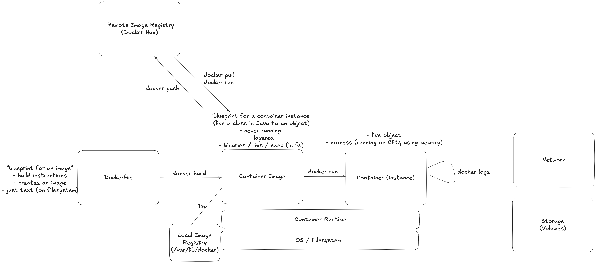

### Why last week's image did not run on the Mac

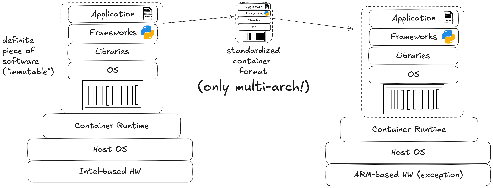

### Live demo: from a local process to two container instances

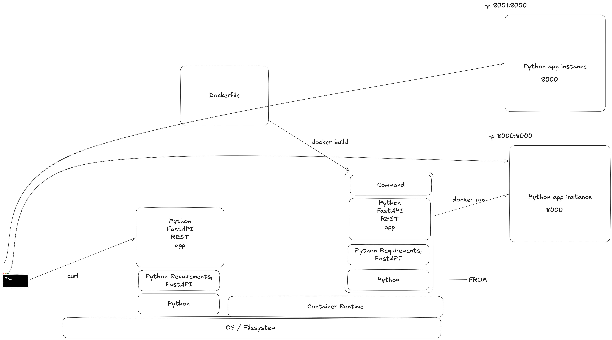

The code from the demo is in [`code/`](code/) – see [code/README.md](code/README.md) for how to run it.

### **Content Overview**

**Recap: why last week's demo failed**
   - The image was built in a codespace on `linux/amd64` and pulled on an Apple Silicon Mac (`arm64`). The container runtime abstracts the operating system, not the CPU: an image contains binaries for one architecture.
   - Portability across architectures needs multi-platform images (one tag, one variant per architecture).

**The Docker components and how they relate**
   - **Dockerfile:** the blueprint for an image – build instructions, just text on the file system. `docker build` turns it into an image.
   - **Image:** the blueprint for a container instance (class → object). Never running, layered, contains binaries, libraries and executables. Identified by an immutable ID; names and tags are just pointers to it – one image can have several tags (`nginx:latest`, `nginx:1`, ...).
   - **Container:** the live instance – a process running on the CPU, using memory. Each container gets its own ID, which is also its hostname.
   - **Registries:** `docker pull` and `docker push` move images between the local image store (`docker images`) and a remote registry such as Docker Hub. `docker run` pulls an image only if it is not available locally.
   - Useful commands: `docker images`, `docker ps -a`, `docker logs <id>`, `docker tag`, `docker rmi` (removes a tag, or the image once no tag is left), `docker rm`.
   - Immutability: you cannot change an image, but you can build a new image on top of it (`FROM <your-image>`).

**A REST service in a container** (FastAPI shopping list, generated with Copilot)
   - Endpoints: `/hello` (returns the hostname), `/crash` (simulated error), CRUD on `/shopping-list` – create, read, update, delete.
   - First run locally as a plain process and test with `curl`; then containerize.
   - Dockerfile instructions: `FROM` (base image), `WORKDIR`, `COPY` (from the build context into the image), `RUN` (execute at build time, e.g. `pip install`), `EXPOSE`, `CMD` (what `docker run` executes).
   - The build context is the directory passed to `docker build`. `COPY` can only see files in there: `docker build -f code/Dockerfile-backend -t backend:v1 code/backend-fastapi`.
   - Delete `main.py` locally: the local process no longer starts, the container still does – the file is part of the image.
   - **Port mapping:** the app listens on port 8000 *inside* the container; `curl localhost:8000` fails from outside. `docker run -p 8000:8000 ...` publishes it.
   - Two versions in parallel: `backend:v1` on port 8000 and `backend:v2` on port 8001 (`-p 8001:8000`), both listening on 8000 inside – the basis for blue/green.
   - Other languages, same pattern: Spring Boot, Quarkus, Go and Rust use **multi-stage builds** – a build stage compiles, a slim runtime stage only gets the result (e.g. a JAR on a JRE). Running as a non-root user is good practice.

### **Homework**

- Put an application of your own into a container: write a Dockerfile, build an image, run it, reach it via a port mapping. Any language. Or start from the code in [`code/`](code/).
- Not sure where to start? Follow the tutorials [01 – Docker Basics](tutorials/01-docker-basics.md) and [02 – A REST API in a Container](tutorials/02-rest-api-in-a-container.md).
- Stuck? Bring your problem to the next session or send it by email.

---

### **Learning Objectives**

By the end of this lecture, students will be able to:
- Explain the roles of Dockerfile, image, container and registry and the commands that connect them.
- Distinguish image IDs from tags and explain why images are immutable.
- Write a Dockerfile for a simple application and explain `FROM`, `WORKDIR`, `COPY`, `RUN`, `EXPOSE` and `CMD`.
- Explain the build context.
- Publish a container port with `-p` and explain why it is needed.
- Explain why an image may not run on a different CPU architecture and how multi-platform images solve this.

---

### **Student/Review Questions**

1. Describe the role of a Dockerfile, an image and a container in one sentence each. Which of them is running?
2. What is the difference between an image ID and a tag? Can two tags point to the same image?
3. What does `docker run` do if the image is not available locally? And if it is?
4. Why does the hostname returned by an application change when you move it into a container?
5. What is the build context of `docker build`, and why does `COPY` fail if it is wrong?
6. What is the difference between `RUN` and `CMD` in a Dockerfile?
7. An application listens on port 8000 in a container, but `curl localhost:8000` on the host fails. Why, and how do you fix it?
8. How can two containers both listen on port 8000 inside and still run on the same host?
9. You delete the source file of an application after building its image. Does the container still start? Why?
10. What is a multi-stage build, and why is it useful for compiled languages like Java or Go?
11. Why did an image built in a codespace fail on an Apple Silicon Mac? How can this be solved?

## 2026-Nov-13 Looking Inside Containers, Networks, Storage and Docker Compose

### Recap: the backend in a container, and a container just for debugging

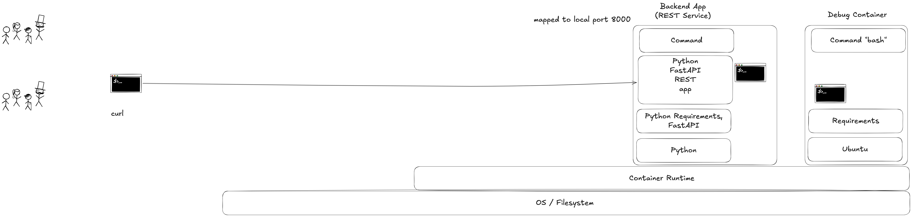

### A frontend for the backend – first as a local process

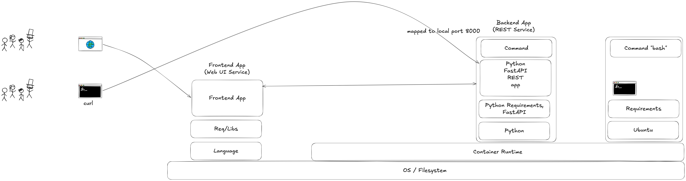

### Both in containers: how do they find each other?

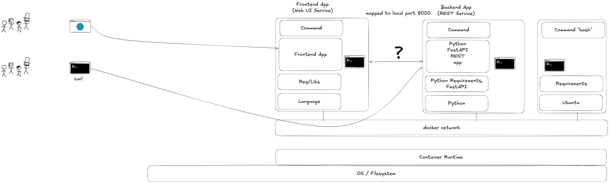

### Scaling: a load balancer in front of two backend instances

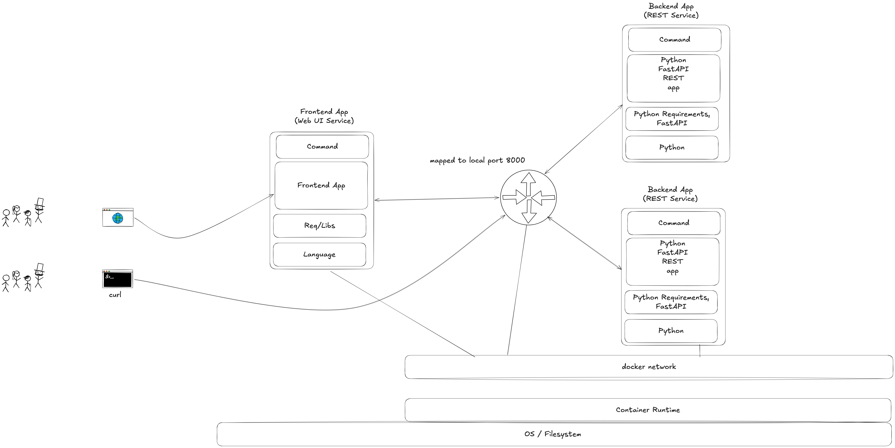

### **Content Overview**

**Recap and the tutorials**
   - The demo code is in [`code/`](code/), step-by-step walkthroughs are in [`tutorials/`](tutorials/). They follow the lecture – if containers are new to you, do them.
   - Last week in ten minutes ([tutorial 02](tutorials/02-rest-api-in-a-container.md)): the FastAPI shopping list as a local process, tested with `curl`, then Dockerfile, `docker build`, `docker run -p 8000:8000`.

**Looking inside containers** ([tutorial 03](tutorials/03-looking-inside-containers.md))
   - `docker run alpine:3.22` or `docker run ubuntu` starts and exits right away: the default command is a shell, and without a terminal it has no input and ends.
   - A command after the image name replaces the default command: `docker run ubuntu env`, `ls`, `whoami` (`root` inside, `codespace` outside). Each run creates a new container that exits after the command.
   - `-i` keeps the input open, `-t` gives a terminal: `docker run -it ubuntu bash` opens a shell inside the container. The hostname is the container ID, `/etc/os-release` shows Ubuntu. `exit` ends the shell – and the container, because the shell is its main process.
   - `docker exec` runs an additional process in a *running* container: `docker run` takes an image and creates a container, `docker exec` takes a running container. With `--name web` you can use the name instead of the ID: `docker exec web ps` shows the nginx master and worker processes, `docker exec -it web sh` opens a shell, and `ps` inside also shows that shell.
   - Change the start page in the running nginx container: `curl` shows the change immediately. `docker diff web` lists what changed in the container's writable layer. A second container from the same image shows the original page. Leaving the `exec` shell with `exit` does not stop the container – nginx is still process 1.
   - `docker commit web my-nginx:v1` turns the container's state into a new image (slightly smaller: the new `index.html` is shorter than the default page). `docker history` shows only an anonymous layer for it. The same change in a Dockerfile (`COPY index.html ...`) shows up as a readable, reproducible step – the Dockerfile is the default way to build images.
   - `docker history` on the shopping API image: the layers of the Python base image at the bottom, our steps on top. `COPY` and `RUN` add files and have a size; `EXPOSE` and `CMD` only change metadata and show `0B`.
   - Options go before the image name: `docker run -d -p 8080:80 --name newweb my-nginx:v1`.

**Networks, storage and Compose** (slides)
   - Containers are isolated from each other. `docker network create`, `docker network connect <network> <container>`, or `--network` with `docker run`. `bridge` is the default driver. `docker inspect` works for containers, images and networks.
   - The writable layer is gone when the container is removed. To keep data (a database, files) or to read configuration from outside, mount a part of the host's file system:
     - **bind mount**: `-v /path/on/host:/path/in/container` – a direct reference to a host directory
     - **volume**: `-v myvolume:/path/in/container` – a Docker-managed object, created if it does not exist, listed and removed with `docker volume ls` / `docker volume rm`, easier to back up and migrate
   - A Dockerfile can declare a mount point (`VOLUME`), but not a network – networks belong to running containers, not to an image.
   - **Docker Compose** describes containers, networks and volumes of an application in one YAML file. It does nothing you could not do with `docker` commands, but replaces a sequence of error-prone steps with `docker compose up`. A **service** describes how to run a container; Compose starts one or more containers from it.

**Frontend and backend** ([tutorial 04](tutorials/04-container-networking.md))
   - The Flask frontend in [`code/frontend-flask`](code/frontend-flask/) calls the backend at `BACKEND_URL`, default `http://127.0.0.1:8000`.
   - Frontend as a local process, backend in a container with `-p 8000:8000`: it works. Items added with `curl` appear in the frontend – the state is in the backend, the frontend only reads and changes it. A wrong port in `BACKEND_URL` → "Could not reach backend".
   - `docker stop` and `docker start` keep the container's file system and configuration, but the process starts fresh – the in-memory shopping list is empty again.
   - Frontend in a container with `BACKEND_URL=http://127.0.0.1:8000`: fails, because `127.0.0.1` is now the frontend container itself. With `http://backend:8000` on the default `bridge` network: the name cannot be resolved – the default bridge has no name resolution for containers.
   - Slim images have no `ping`, `curl` or `nc`. Instead of installing tools in a running container, use a separate **toolbox container** ([`code/toolbox`](code/toolbox/): Alpine with curl, ping, nslookup, netcat) in the same network.
   - `docker network create shop-net`, `docker network connect shop-net backend`, `docker network inspect shop-net` shows the connected containers and their IP addresses. On a user-defined network, the container name is a DNS name.
   - `docker build` failed with "parent snapshot ... does not exist": a broken build cache, fixed with `docker builder prune`.

**When the environment is broken**
   - In the codespace used in class, the names resolved (`nslookup backend` worked), but `ping`, `curl` and `nc` all timed out – with plain `docker` commands and with Compose. A new codespace with the same code worked right away.
   - So the commands were right; the Docker network setup inside that codespace was broken. If you see something like this: push your code and create a new codespace (or run "Codespaces: Rebuild Container").

**Docker Compose live** ([tutorial 06](tutorials/06-docker-compose.md))
   - [`code/compose.yaml`](code/compose.yaml): `backend` and `frontend`, each with `build:`, the frontend with `ports`, `environment` and `depends_on`.
   - `docker compose up` builds the images, creates the network `shopping_default` and starts the containers. The toolbox joins `shopping_default`: `ping frontend`, `ping backend` and `curl backend:8000/shopping-list` work. `docker compose down` removes containers and network.

**Scaling with a load balancer** ([tutorial 07](tutorials/07-scaling.md))
   - [`code/compose-lb.yaml`](code/compose-lb.yaml): two backend replicas and a Traefik proxy; the frontend calls `http://proxy:80`.
   - The service name `backend` resolves to both replicas, but name resolution alone is no load balancing: the client decides which of the addresses it uses. The proxy distributes each request.
   - `curl localhost:8000/hello` repeatedly: the hostname alternates between the two instances (round robin per request). Through the frontend it looks stuck on one instance: every page calls the backend twice (`/hello` and `/shopping-list`), so `/hello` always lands on the same one.
   - Traefik in detail: next session.

**Outlook: the PVL**
   - Think about a distributed application you would like to build. Next session: examples from last year's groups and suggestions to start with. You can start the PVL now.

### **Homework**

- Work through tutorials [03](tutorials/03-looking-inside-containers.md), [04](tutorials/04-container-networking.md), [06](tutorials/06-docker-compose.md) and [07](tutorials/07-scaling.md).
- Think about an idea for your PVL: what could be a distributed application or scenario?

---

### **Learning Objectives**

By the end of this lecture, students will be able to:
- Explain why a container from a base image like `ubuntu` exits immediately, and how `-i`, `-t` and a command after the image name change that.
- Distinguish `docker run` from `docker exec` and use both to get a shell in a container.
- Explain the writable container layer and inspect it with `docker diff`.
- Compare `docker commit` with a Dockerfile and read `docker history`.
- Explain why `127.0.0.1` and container names do not work between containers on the default bridge, and connect containers with a user-defined network.
- Debug container connectivity with a separate toolbox container.
- Distinguish bind mounts from volumes and name use cases for both.
- Describe a multi-container application in a Compose file and start it with `docker compose up`.
- Explain why several instances of a service need a load balancer in front of them.

---

### **Student/Review Questions**

1. Why does `docker run ubuntu` exit right away? What changes with `docker run -it ubuntu bash`?
2. What do `-i` and `-t` do?
3. What is the difference between `docker run` and `docker exec`? Which one creates a new container?
4. You type `exit` in a shell opened with `docker run -it` and in one opened with `docker exec -it`. Why does the container stop in one case and keep running in the other?
5. You change a file inside a running container. Where is the change stored, and how can you see it? Does a second container from the same image see it?
6. Why is a Dockerfile better than `docker commit` for building images? What does `docker history` show in both cases?
7. What survives `docker stop` and `docker start`, and what does not?
8. A frontend container calls `http://127.0.0.1:8000` to reach a backend in another container. Why does this fail?
9. Why can containers on the default bridge network not reach each other by name, while on a user-defined network they can?
10. Why do slim images have no `ping` or `curl`, and how can you debug network problems anyway?
11. What is the difference between a bind mount and a volume? Give a use case for each.
12. Why can a Dockerfile declare a volume, but not a network?
13. What does `docker compose up` do that you would otherwise do by hand? Which network does it create?
14. What is a service in a Compose file, and how does it relate to containers?
15. Two backend instances are running. Why does the frontend need a load balancer in front of them?
16. Explain every switch in `docker run -d --rm --name web --network shop-net -p 8080:80 -e MODE=dev -v data:/data nginx`.
